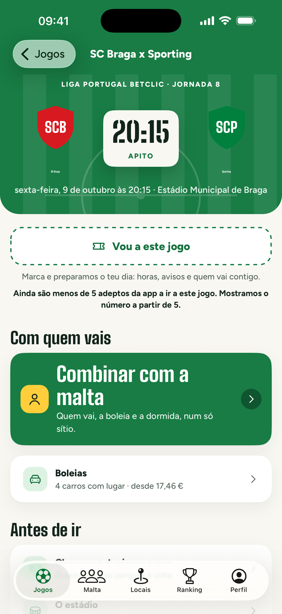
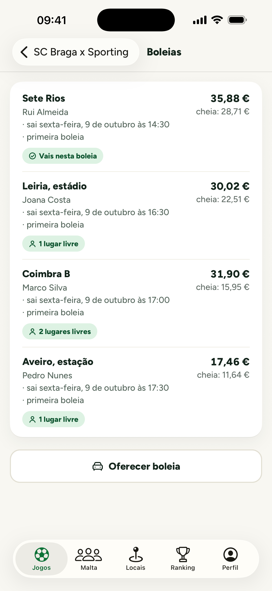
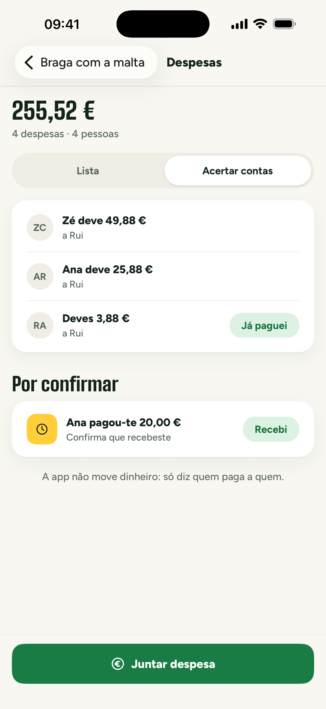
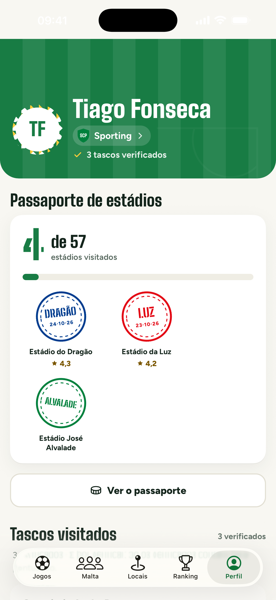

# AwayDay

**A match-day companion app for football fans in Portugal, built end-to-end with Claude Code.**

AwayDay helps a fan plan and live an away day. They can see upcoming games and get to the stadium, find places nearby
that other fans rated, share a ride and split its cost, and settle the group's expenses afterwards. Supporters' clubs
(*Casas* and *Núcleos*) can also use it to organise their coach trips to a game.

It is a real product, not a prototype. It runs on a production Supabase backend and is in external beta on iOS through
TestFlight. I am currently showing it to supporters' clubs across the country.

**Try it on iPhone:** [TestFlight public beta](https://testflight.apple.com/join/VT2T9PtF) · the interface is in
European Portuguese.

<p>
  
  
  
  
</p>

---

## What it does

| Area | What the fan gets |
|---|---|
| **Games** | Upcoming fixtures from the Portuguese leagues, the cups and the European competitions. Each game has a stadium sheet (cover, shade, weather), the walking route and the transport options. A match-day clock gives one suggestion for each phase of the day. |
| **Places** | Bars and restaurants within a 20-minute walk of the stadium, rated by fans. A live "how busy is it" map is built only from anonymous aggregates. |
| **Rides** | Fans offer and join car rides to the game. The cost per passenger (fuel and tolls, split fairly) is computed on the server. |
| **Groups** | Fans plan a trip with friends: who's going, where to stay, and shared expenses split to the cent, with a settle-up that keeps the number of transfers low. |
| **Viagens da Casa** | Supporters' clubs organise the coach to a game: price, stops, vehicles, a members-only code, a waiting list that moves up by itself, manual bookings, payment tracking and notices to everyone on board. |
| **Passport and ranking** | Stadium stamps, missions completed with a photo taken on the spot, and a season recap. |

## How it was built: AI-first engineering

This whole project, about 80k lines of TypeScript and SQL across 317 commits since September 2026, was built with
[Claude Code](https://claude.com/claude-code). I worked as the product owner and the reviewer, and the agent wrote the
code. The point was not to "let the AI write code" but to make an AI-driven workflow safe enough for a production app
that handles real money and real locations.

- **Project rules the agent must follow:** [`CLAUDE.md`](CLAUDE.md) holds the rules that can never be broken:
  - money is always integer cents;
  - all times are stored in UTC;
  - every table has row-level security;
  - computed values come only from the server;
  - no new dependencies without asking;
  - no `any`.

  It also sets the order of work for every feature: migration → generated types → API → hooks → UI.
- **Plan before code:** every feature starts as a written plan that I approve, then runs through subagents with a
  review after each task. The structural decisions and their reasons are logged in
  [`docs/DECISOES.md`](docs/DECISOES.md).
- **Tests as the safety net:** the agent cannot call a task done until `npm run check` passes. That runs typecheck,
  lint, Vitest and Jest with Testing Library. The suite has:
  - 79 unit and UI test files;
  - 51 SQL test files that run against the database inside rolled-back transactions;
  - 18 end-to-end flows in [Maestro](https://maestro.mobile.dev).

  Money, ride cost and settle-up must ship with tests, including the edge and rounding cases.
- **AI inside the product:** two features call the Anthropic API from Edge Functions, behind explicit user consent and
  a monthly budget cap:
  - the match-day tip;
  - the season recap.
- **The agent beyond code:** the same workflow produced the store listings, the privacy policy pages, and the demo
  videos. The videos are recorded with Maestro on the simulator and edited with [Remotion](https://www.remotion.dev).

## Architecture

```
Expo app (React Native, TypeScript strict)
  ├─ Expo Router screens: composition only
  ├─ src/features/<feature>/: api.ts · hooks/ · components/
  ├─ TanStack Query for server state, Zustand for UI state
  └─ Supabase JS (publishable key only)
        │
Supabase
  ├─ Postgres + PostGIS: 151 migrations, RLS on every table, security-definer RPCs
  ├─ 14 Edge Functions (Deno): fixtures and weather sync, ride cost, notifications, AI tips
  ├─ Auth: email with a code, Sign in with Apple, Google
  └─ pg_cron, Realtime, Storage
```

Some design choices worth noting:

- **Privacy by construction.**
  - A fan's location is never exposed to anyone else.
  - The map reads aggregates that are published only when at least 5 people are there.
  - Check-ins are deleted after 48 hours, and only Edge Functions ever read them.
- **No third-party API keys on the client.** External data (fixtures, maps, weather) is fetched by Edge Functions and
  cached in Postgres.
- **The server is the source of truth for money.** The client never sends a price, a balance or a settlement.

## Stack

Expo SDK 57 · React Native 0.86 · React 19 · TypeScript 6 (strict) · Expo Router · TanStack Query · Zustand ·
Supabase (Postgres, PostGIS, Auth, Edge Functions, Realtime, Storage) · Vitest · Jest · Maestro · EAS Build and Update.

## Running it locally

```bash
mise install          # Node 24
npm install
cp .env.example .env.local   # Supabase URL and publishable key
npx expo start --clear
npm run check         # typecheck + lint + all unit and UI tests
```

The app also runs without a backend: it falls back to the fixture catalogue bundled in the app. The full developer
guide is in Portuguese, in [`docs/README.pt.md`](docs/README.pt.md).

---

Built by **Martim Henriques** · [martim565@gmail.com](mailto:martim565@gmail.com)
